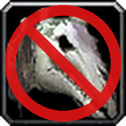
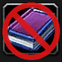

# AutoPassDeathcharger

 

WoW 3.3.5a addon. It passes every loot roll on Reins of the Naxxramas Deathcharger (item 23193) and on Manual: Heavy
Frostweave Bandage (item 39152) and hides
that roll's window. 

## Changes

- 1.1.1: no chat line when a roll is passed (a commented-out line in the Lua file brings it back).
- 1.1.0: Manual: Heavy Frostweave Bandage (39152) is passed too.

## Install

Copy the folder `AutoPassDeathcharger` into `<WoW folder>\Interface\AddOns`.

